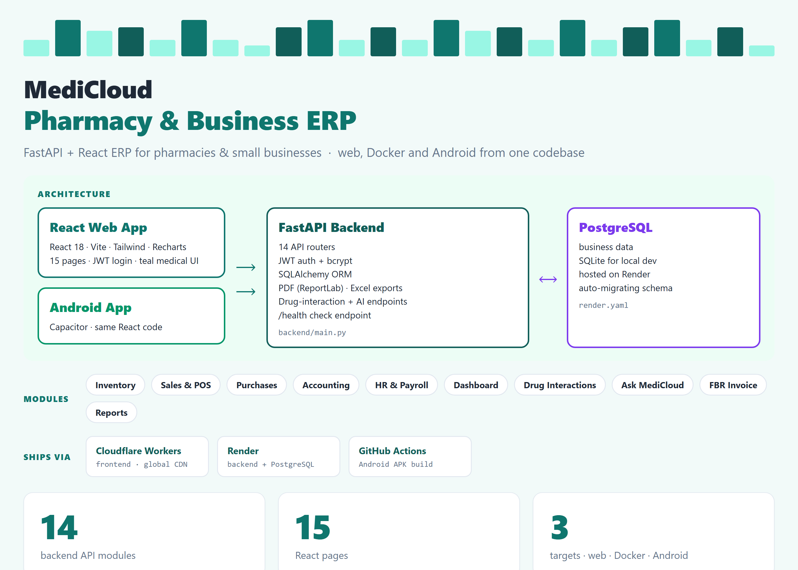

# MediCloud

> Cloud-based pharmacy & business ERP for Pakistani businesses.
> *(formerly ProBiz ERP)*



A full-stack ERP built for pharmacies and small businesses: inventory, sales & POS,
purchases, accounting, HR & payroll, subscriptions and a KPI dashboard — plus
pharmacy-specific features (salt/generic search, near-expiry alerts, FBR sales-tax
invoices, a drug-interaction checker and an AI assistant). One codebase runs as a
web app, in Docker, and as an Android app, with a clean white-and-teal medical theme
and light/dark mode.

## Live demo

| What | URL |
|------|-----|
| App (frontend) | https://probiz-erp.raees-malik89.workers.dev |
| API (backend) | https://probiz-erp-backend.onrender.com |

## Tech stack

| Layer | Technology |
|-------|------------|
| Backend | Python 3.11, FastAPI, SQLAlchemy, JWT (python-jose) + bcrypt, ReportLab (PDF), openpyxl (Excel) |
| Database | PostgreSQL (production), SQLite (local development) |
| Frontend | React 18, Vite, React Router, Tailwind CSS 3, Recharts, Axios |
| AI | Anthropic Claude (optional — "Ask MediCloud" assistant) |
| Mobile | Capacitor (Android) |
| Hosting | Cloudflare Workers (frontend), Render (backend + PostgreSQL) |
| DevOps | Docker, Docker Compose, GitHub Actions (Android APK build) |

## Modules

| Module | Backend router |
|--------|----------------|
| Authentication & roles | `routers/auth.py`, `routers/admin.py` |
| Inventory (products, categories, salt/generic search, stock & expiry alerts) | `routers/inventory.py` |
| Sales & POS (invoices, customers, payments, drug-interaction warnings) | `routers/sales.py` |
| Purchases (purchase orders, suppliers) | `routers/purchases.py` |
| Accounting (chart of accounts, transactions, P&L) | `routers/accounting.py` |
| HR & Payroll (employees, attendance, payslips) | `routers/payroll.py` |
| Dashboard KPIs | `routers/dashboard.py` |
| Company settings (name, address, NTN/STRN for FBR invoices) | `routers/settings.py` |
| Drug-interaction checker | `routers/interactions.py` |
| AI assistant ("Ask MediCloud") | `routers/assistant.py` |
| Data exports (Excel/CSV) | `routers/exports.py` |
| Subscriptions & demo requests | `routers/subscription.py`, `routers/demo_requests.py` |

## Pharmacy features

- **Salt / generic search** — find and sell products by active ingredient, not just brand.
- **Near-expiry alerts** — flag stock approaching its expiry date.
- **FBR sales-tax invoice** — tax invoices carrying the business NTN/STRN, as PDF or print.
- **Drug-interaction checker** — warns on major interactions at the POS
  (`POST /api/interactions/check`), backed by `backend/data/drug_interactions.json`.
- **Ask MediCloud** — an optional AI assistant over your business data
  (`POST /api/assistant/ask`, status at `/api/assistant/status`). Disabled until an
  Anthropic API key is set, so the app runs fine without it.

## Run with Docker (recommended)

```bash
cp .env.example .env        # then set POSTGRES_PASSWORD and SECRET_KEY
docker compose up -d --build
docker compose logs backend # first start prints the admin login
```

- App: http://localhost
- API: http://localhost:8000 (health check: `/health`)

## Run locally without Docker

Backend (uses SQLite by default):

```bash
cd backend
cp .env.example .env        # set SECRET_KEY
pip install -r requirements.txt
python seed.py              # prints the admin login once
uvicorn main:app --reload --port 8000
```

Frontend:

```bash
cd frontend
npm install
npm run dev                 # http://localhost:3000
```

On Windows you can also double-click `start-backend.bat` and `start-frontend.bat`,
or `start-local-network.bat` to share the app with other PCs on your network.

## Login accounts

`seed.py` creates an admin, a manager and a cashier on first run.

- Admin email: `SEED_ADMIN_EMAIL` (default `admin@probiz.pk`)
- Passwords: `SEED_ADMIN_PASSWORD` and `SEED_DEMO_PASSWORD`. If they are not set,
  random passwords are generated and printed once in the backend log.

## Key environment variables

| Variable | Purpose |
|----------|---------|
| `SECRET_KEY` | JWT signing key (required) |
| `DATABASE_URL` | PostgreSQL connection (falls back to SQLite locally) |
| `ALLOWED_ORIGINS` | Comma-separated front-end origins for CORS |
| `SEED_ADMIN_PASSWORD`, `SEED_DEMO_PASSWORD` | Seed/boot login passwords |
| `ANTHROPIC_API_KEY` | Enables the "Ask MediCloud" AI assistant (optional) |
| `ANTHROPIC_MODEL` | Claude model to use (optional; `claude-haiku-5-5` is cheapest) |

## Android app

The **Build Android APK** workflow (`.github/workflows/build-apk.yml`) builds a debug APK
on every push that changes `frontend/`. Download it from the workflow run's **Artifacts**.
Set the repository variable `REACT_APP_API_URL` to point the app at your backend.

## Deployment

Production runs the frontend on Cloudflare Workers and the backend + database on Render.
Both auto-deploy on push to `master`.

| Target | Config |
|--------|--------|
| Cloudflare Workers (frontend) | `frontend/wrangler.jsonc` |
| Render (backend + PostgreSQL) | `render.yaml` |
| Railway (alternative) | `backend/railway.toml`, `frontend/railway.toml` |
| Vercel (alternative frontend) | `vercel.json`, `frontend/vercel.json` |

## Project structure

```text
probiz-erp/
├── .github/workflows/build-apk.yml   # Android APK CI
├── backend/                          # FastAPI app, models, routers, seed
│   └── data/drug_interactions.json   # drug-interaction dataset
├── frontend/                         # React app (Vite) + Capacitor Android project
│   └── wrangler.jsonc                # Cloudflare Workers config
├── docs/                             # user manual, technical guide, diagram
├── docker-compose.yml
├── .env.example
├── render.yaml · vercel.json
└── start-*.bat                       # Windows helpers
```

## Author

**Muhammad Raees**, DevOps & Full-Stack Engineer
[GitHub](https://github.com/raeesmalik89-oss) · [LinkedIn](https://linkedin.com/in/muhammad-raees081489)
